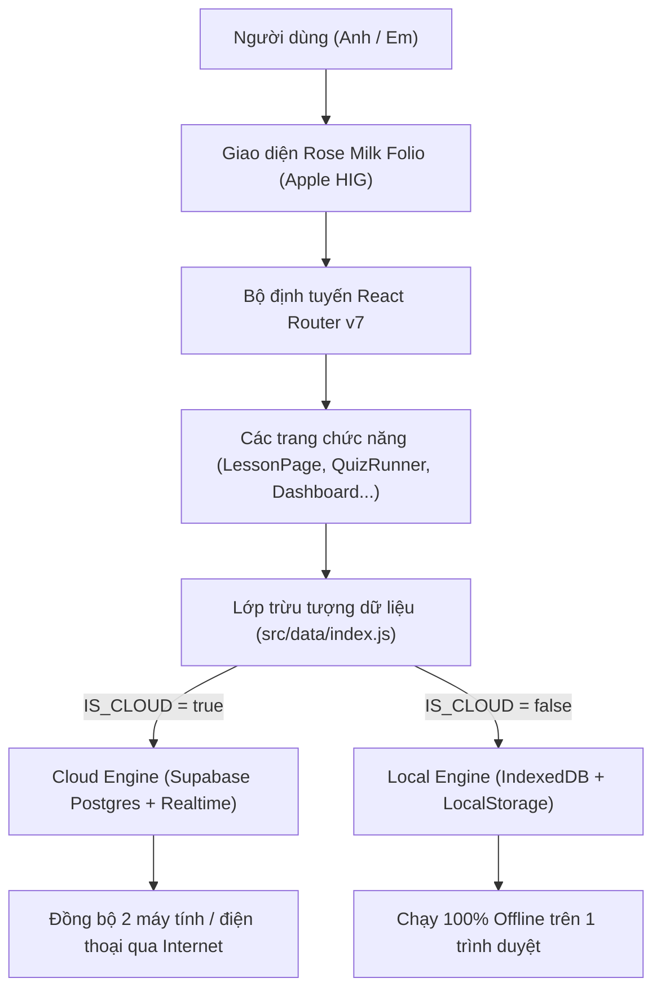
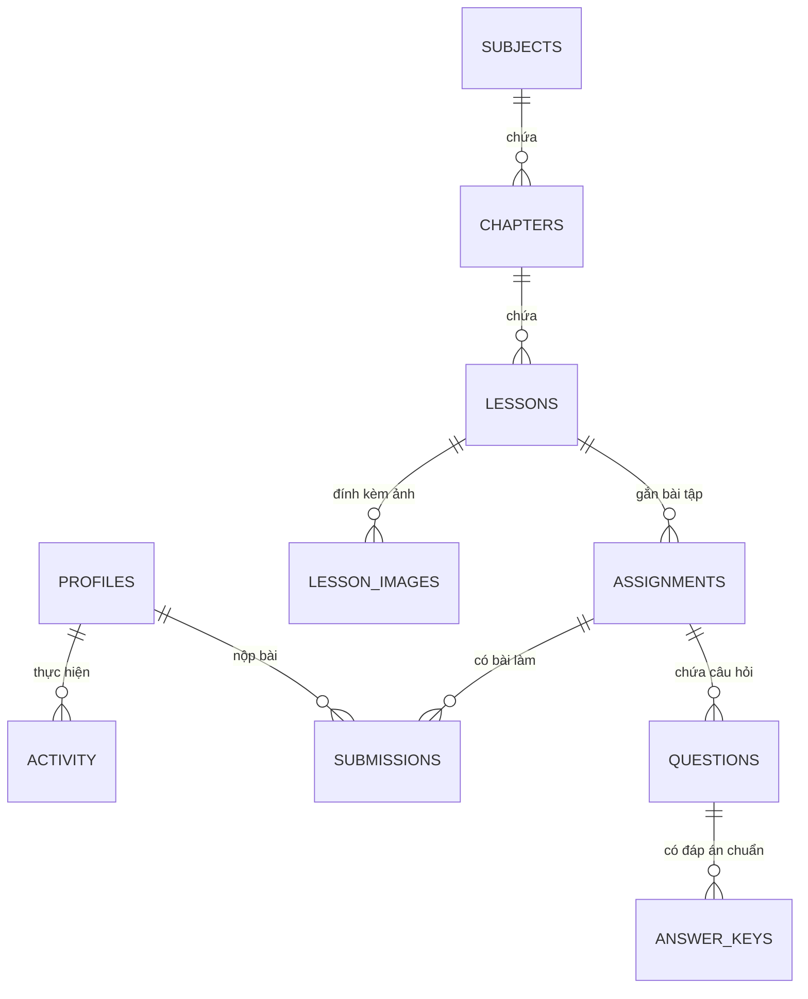
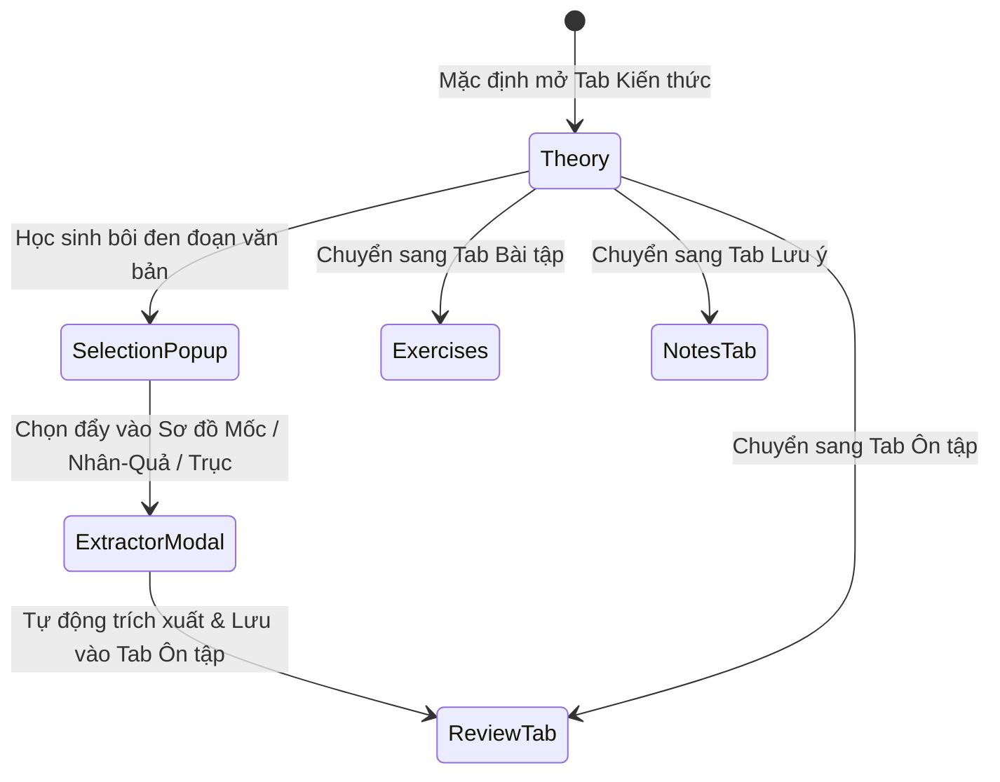
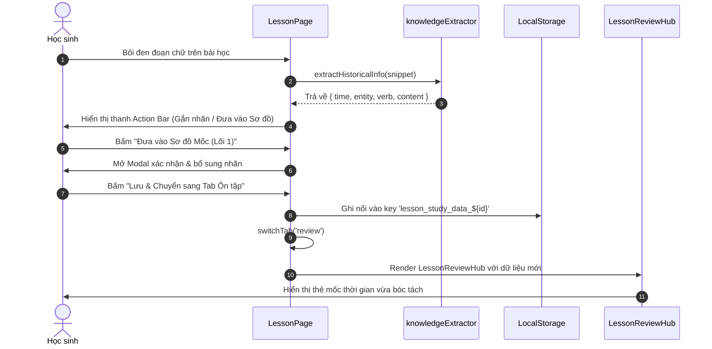

# BẢN ĐẶC TẢ KIẾN TRÚC & THIẾT KẾ TOÀN DIỆN
## HỆ THỐNG "HỌC CÙNG NHAU" — ROSE MILK FOLIO (LỊCH SỬ 12)

> **Tài liệu nghiên cứu & rà soát lỗi chuyên sâu**  
> *Thời gian xuất bản: 04/11/2026*  
> *Phiên bản hệ thống: 1.0.0 (Vite 7.3 + React 19 + Supabase/IndexedDB Dual-Backend)*

---

## MỤC LỤC TỔNG QUAN

1. **TỔNG QUAN HỆ THỐNG & TRIẾT LÝ THIẾT KẾ**
   - 1.1. Sứ mệnh sản phẩm & Đối tượng người dùng
   - 1.2. Triết lý thẩm mỹ Rose Milk Folio (Apple Human Interface Guidelines)
   - 1.3. Ngăn xếp công nghệ (Technology Stack)

2. **KIẾN TRÚC TỔNG THỂ (HIGH-LEVEL ARCHITECTURE)**
   - 2.1. Mô hình Dual-Engine: Cloud (Supabase) vs Local (IndexedDB)
   - 2.2. Bus sự kiện phản ứng thời gian thực (Reactive Event-Driven Architecture)
   - 2.3. Cấu trúc định tuyến & Cây phân tầng Component (Routing & Hierarchy)

3. **MÔ HÌNH DỮ LIỆU & LƯU TRỮ (DATA LAYER & PERSISTENCE)**
   - 3.1. Lược đồ cơ sở dữ liệu quan hệ (Relational DB Schema)
   - 3.2. Cơ chế lưu trữ IndexedDB Object Stores cho chế độ Offline
   - 3.3. Bản đồ dữ liệu LocalStorage (State & Cache Footprint)
   - 3.4. Hệ thống phân loại ma trận 5 Lõi Tri Thức (THPT Quốc Gia 2026)

4. **GIẢI PHẪU CHI TIẾT CÁC MODULE CỐT LÕI (MODULE DEEP DIVE)**
   - 4.1. Module Trung tâm: `LessonPage.jsx` & Kiến trúc 4 Tab Folio
   - 4.2. Lõi 1: `MilestoneDiagram.jsx` (Trục mốc thời gian, gom cụm & bẫy niên biểu)
   - 4.3. Lõi 2 & 4: `AxesDiagram.jsx` (Trục chủ thể & Phân đôi bản chất Bất biến vs Vận động)
   - 4.4. Lõi 3: `CauseEffectDiagram.jsx` (Sơ đồ Nhân – Quả 3 khối & Bẫy phóng đại cờ đỏ 🚩)
   - 4.5. Lõi 5: `ComparisonDiagram.jsx` (Bàn cân đối chiếu đa chiều & Danh sách từ cấm thời chiến ⛔)
   - 4.6. Trạm khảo thí THPTQG 2026: `QuizRunner.jsx` & Trích xuất bút dạ quang hồng
   - 4.7. Trạm Radar cảnh báo bẫy & Cẩm nang chống sai ngu: `LessonNotesHub.jsx`
   - 4.8. Không gian học tập tương tác: Thẻ lật 3D (Active Recall Flashcards)

5. **LUỒNG DỮ LIỆU & TƯƠNG TÁC NGƯỜI DÙNG (DATA FLOWS & INTERACTION LOOPS)**
   - 5.1. Luồng Bôi đen văn bản ➔ Trích xuất NLP Regex ➔ Nạp tự động vào Tab Ôn tập
   - 5.2. Luồng Làm bài thi trắc nghiệm ➔ Lưu nháp liên tục ➔ Nộp bài & Khớp dẫn chứng SGK
   - 5.3. Luồng Quản lý & Chấm bài của Giáo viên (Anh ⇄ Em)

6. **BẢN ĐỒ RỦI RO & DANH MỤC LỖI TIỀM ẨN CẦN RÀ SOÁT (BUG AUDIT MATRIX)**
   - 6.1. Lỗ hổng Thứ tự State Hook & Vùng chết thời gian (TDZ)
   - 6.2. Nguy cơ tràn bộ nhớ LocalStorage (QuotaExceededError)
   - 6.3. Xung đột đồng bộ giữa 2 chế độ Cloud / Local
   - 6.4. Tính tương thích khi cấu trúc JSON thay đổi (Migration Fallback)
   - 6.5. Rò rỉ bộ nhớ (Memory Leaks) & Dọn dẹp Timer / Event Listeners
   - 6.6. Trải nghiệm trên thiết bị di động (Mobile Touch & Layout Overflow)
   - 6.7. Rủi ro logic nghiệp vụ và bảo mật phân quyền

---

## 1. TỔNG QUAN HỆ THỐNG & TRIẾT LÝ THIẾT KẾ



### 1.1. Sứ mệnh sản phẩm & Đối tượng người dùng
- **Mục tiêu**: Nền tảng học tập cá nhân hoá chuyên sâu môn **Lịch Sử lớp 10, 11, 12** bám sát chương trình sách giáo khoa mới (*Kết nối tri thức với cuộc sống*) và định dạng ma trận đề thi Tốt nghiệp THPT Quốc Gia từ năm 2026 của Bộ Giáo dục và Đào tạo.
- **Mô hình người dùng "Anh ⇄ Em"**:
  - **Anh (Teacher / Quản lý)**: Giao đề thi, thiết lập bài giảng, chấm điểm các câu tự luận/tệp đính kèm, chỉnh sửa khung tri thức.
  - **Em (Student / Người học)**: Đọc kiến thức bài giảng, làm bài tập trắc nghiệm, tương tác với 4 mô hình sơ đồ tư duy lõi, lật thẻ phản xạ 3D, đọc cảnh báo radar chống bẫy đề thi.

### 1.2. Triết lý thẩm mỹ Rose Milk Folio
- Lấy cảm hứng từ giao diện **Apple Human Interface Guidelines (HIG)** kết hợp với phong cách tạp chí học thuật cao cấp (**Editorial Folio**).
- **Gam màu chủ đạo**:
  - `Background`: Màu giấy ngà ấm dịu `#FCFBF8`, bề mặt card mềm `#FFFFFF` và nền tối `#0F141C` khi chuyển chế độ.
  - `Accent Rose Milk`: Hồng thanh nhã `#E11D48`, đỏ rượu `#BE123C`, hồng nhạt `#FFF0F3` đại diện cho màu "Bút dạ quang hồng".
  - `Tương phản phụ trợ`: Xanh đại dương `#0284C7` (Chủ quan/Ngoại giao), Xanh lục ngọc `#15803D` (Thành tựu/Tương đồng), Vàng hổ phách `#D97706` (Cảnh báo/Bẫy đề thi).
- **Trải nghiệm tương tác**:
  - `Segmented Tabs`: Chuyển đổi trạng thái mượt mà không cuộn trang.
  - `Micro-animations`: Đổ bóng tinh tế (`box-shadow: 0 4px 20px rgba(0,0,0,0.04)`), hiệu ứng lật thẻ 3D (`perspective: 1000px`), chuyển tab không gây giật khung hình.

### 1.3. Ngăn xếp công nghệ (Technology Stack)
- **Frontend Core**: React 19, React Router DOM v7.
- **Build Tool**: Vite 7.3 (HMR tức thì, Rollup bundling, PostCSS hỗ trợ).
- **Xử lý tài liệu & văn bản**:
  - `marked`: Chuyển đổi Markdown bài giảng sang HTML an toàn.
  - `mammoth`: Bóc tách và nhập đề thi từ file `.docx` của giáo viên.
- **Backend & Đồng bộ**:
  - `@supabase/supabase-js v2.45`: Quản lý Auth, cơ sở dữ liệu PostgreSQL và WebSockets Realtime Channel.
  - `IndexedDB API`: Động cơ lưu trữ offline độc lập khi không có mạng.

---

## 2. KIẾN TRÚC TỔNG THỂ (HIGH-LEVEL ARCHITECTURE)

### 2.1. Mô hình Dual-Engine: Cloud vs Local
Kiến trúc tách biệt hoàn toàn tầng giao diện (View) khỏi tầng dữ liệu thông qua file [`src/data/index.js`](file:///e:/web%20học/src/data/index.js):

$$\text{data} = \begin{cases} \text{cloud} & \text{khi } \text{IS\_CLOUD} = \text{true (có biến môi trường VITE\_SUPABASE\_URL)} \\ \text{local} & \text{khi } \text{IS\_CLOUD} = \text{false (chế độ Demo IndexedDB)} \end{cases}$$

Cả 2 engine đều cài đặt chung một giao diện (Interface):
- `data.list(table, queryOptions)`
- `data.get(table, id)`
- `data.insert(table, row)`
- `data.update(table, id, patch)`
- `data.delete(table, id)`
- `data.uploadFile(path, file)`
- `data.fileUrl(path)`
- `data.auth`: `current()`, `signIn()`, `signUp()`, `signOut()`, `onChange()`

### 2.2. Bus sự kiện phản ứng (Reactive Event-Driven Architecture)
Trong file [`src/data/events.js`](file:///e:/web%20học/src/data/events.js), hệ thống sử dụng mô hình Observer:
- Khi có bất kỳ thay đổi nào (thêm bài tập, nộp bài, chấm bài, cập nhật mốc):
  - `emitDataChange()` phát tín hiệu đến tất cả subscribers.
  - Hook [`useLive`](file:///e:/web%20học/src/data/useLive.js) tự động kích hoạt query lại dữ liệu, cập nhật lại component mà không cần reload trang.
  - Ở chế độ Cloud, Supabase Postgres Changes channel tự động gọi `emitDataChange()` khi có biến động từ người dùng thứ hai.

### 2.3. Cấu trúc định tuyến & Cây phân tầng Component
```
App (Router)
├── Layout (Header, Role Switcher Anh/Em, Navigation, Banner, Footer)
│   ├── / (Dashboard: Tiến độ học, bài cần làm, hoạt động gần đây)
│   ├── /mon-hoc (SubjectsPage: Danh sách Lịch Sử 10, 11, 12)
│   ├── /mon/:id (SubjectPage: Các chủ đề/chương của khối lớp)
│   ├── /chuong/:id (ChapterPage: Các bài học trong chương)
│   ├── /bai/:id (LessonPage: Trục trung tâm 4 tab)
│   │   ├── Tab 1: Kiến thức (Nội dung SGK, Bút dạ quang hồng, Trích xuất NLP)
│   │   ├── Tab 2: Bài tập (Danh sách BT1 - BT3, Giao diện làm bài THPTQG 2026)
│   │   ├── Tab 3: Ôn tập (LessonReviewHub: 4 sơ đồ lõi + Thẻ lật 3D)
│   │   │   ├── Mode 1: MilestoneDiagram (Niên biểu thời gian & Nhãn đa chiều)
│   │   │   ├── Mode 2: AxesDiagram (Trục chủ thể & Bản chất Bất biến/Vận động)
│   │   │   ├── Mode 3: CauseEffectDiagram (Nhân - Quả 3 khối & Bẫy phóng đại)
│   │   │   ├── Mode 4: ComparisonDiagram (Đối chiếu đa chiều & Danh sách từ cấm)
│   │   │   └── Mode 5: LessonFlashcards (Thẻ phản xạ lật 3D)
│   │   └── Tab 4: Lưu ý (LessonNotesHub: Radar cảnh báo bẫy & Ghi chú lề)
│   ├── /bt/:id (AssignmentPage: Làm bài tập độc lập)
│   ├── /bt/:id/sua (AssignmentEditor: Giáo viên soạn/nhập đề thi)
│   ├── /nop/:id (SubmissionPage: Chi tiết bài đã nộp, điểm số, lời phê)
│   ├── /cham (GradingInbox: Hộp thư chấm bài dành riêng cho vai Anh)
│   └── /cai-dat (Settings: Đổi vai, xuất/nhập sao lưu JSON, cài đặt hiển thị)
```

---

## 3. MÔ HÌNH DỮ LIỆU & LƯU TRỮ



### 3.1. Lược đồ cơ sở dữ liệu quan hệ (Supabase PostgreSQL)
1. **`profiles`**:
   - `id` (uuid, PK): Khớp với `auth.users.id`.
   - `email` (text), `display_name` (text), `role` (`'teacher'` | `'student'`).
   - `created_at` (timestamptz).
2. **`subjects`**:
   - `id` (text, PK), `title` (text: *Lịch Sử 10, 11, 12*), `color` (text), `description` (text), `position` (int).
3. **`chapters`**:
   - `id` (text, PK), `subject_id` (FK), `title` (text: *Chủ đề 1...*), `position` (int).
4. **`lessons`**:
   - `id` (text, PK), `chapter_id` (FK), `title` (text: *Bài 1: Liên hợp quốc*), `content` (text Markdown chuẩn), `position` (int).
5. **`assignments`**:
   - `id` (text, PK), `lesson_id` (FK), `title` (text), `kind` (`'homework'` | `'exam'`), `time_limit_minutes` (int), `pass_score` (numeric), `shuffle_questions` (bool).
6. **`questions`**:
   - `id` (text, PK), `assignment_id` (FK), `type` (`'mcq'` | `'tf'` | `'short'`), `prompt` (text), `options` (jsonb), `order_index` (int).
7. **`answer_keys`**:
   - `question_id` (PK, FK), `answer` (jsonb), `explanation` (text). *Bảo vệ bằng RLS: Học sinh chỉ xem được sau khi hoàn thành hoặc nộp bài.*
8. **`submissions`**:
   - `id` (text, PK), `assignment_id` (FK), `student_id` (FK), `answers` (jsonb), `files` (jsonb), `score` (numeric), `status` (`'draft'` | `'submitted'` | `'graded'`), `feedback` (text), `started_at`, `submitted_at`, `graded_at`.

### 3.2. Cơ chế lưu trữ IndexedDB (Chế độ Local Demo)
- Object Store **`rows`**:
  - `key` (PK): Định dạng `"${table}:${id}"`.
  - `table` (Index): Lọc nhanh tất cả bản ghi thuộc bảng (VD: lấy tất cả `lessons`).
  - `data` (Object): Bản ghi JSON hoàn chỉnh.
- Object Store **`files`**:
  - Lưu trữ trực tiếp Blob file hình ảnh / tài liệu đính kèm nộp bài trong IndexedDB, không bị giới hạn 5MB như localStorage.

### 3.3. Bản đồ dữ liệu LocalStorage (State & Cache Footprint)

| Khóa LocalStorage | Kiểu dữ liệu | Mục đích sử dụng | Component quản lý |
|---|---|---|---|
| `lesson_study_data_${lessonId}` | `Object JSON` | Lưu 4 mô hình sơ đồ tri thức (milestones, axes, causeEffects, comparisons) riêng cho từng bài học | `LessonReviewHub.jsx` |
| `lesson_highlight_tags_${lessonId}` | `Object JSON` | Lưu danh sách từ khoá được gắn nhãn (#Văn_kiện, #Việt_Nam, #Đổi_mới...) | `LessonPage.jsx` |
| `lesson_notes_${lessonId}` | `Array JSON` | Sổ ghi chép cá nhân, đánh dấu trang và trích đoạn của học sinh | `LessonNotes.jsx` |
| `lesson_radar_data_${lessonId}` | `Object JSON` | Dữ liệu cảnh báo bẫy thi, các cặp khái niệm đánh tráo, danh sách từ nhạy cảm | `LessonNotesHub.jsx` |
| `hcn-draft-${assignmentId}` | `Object JSON` | Tự động lưu bài làm dở của học sinh (đáp án, ghi chú, file đính kèm) phòng khi mất điện/tắt tab | `QuizRunner.jsx` |
| `hcn-local-me` | `String` | Lưu vai trò người dùng hiện tại ở chế độ demo (`demo-teacher` hoặc `demo-student`) | `AuthContext.jsx` |

### 3.4. Hệ thống phân loại ma trận 5 Lõi Tri Thức (THPT Quốc Gia 2026)
Hệ thống được thiết kế theo 5 Lõi tư duy giải phẫu đề thi:
1. **Lõi 1 (Định danh)**: Khớp chuẩn xác *Mốc thời gian* $\leftrightarrow$ *Thực thể lịch sử* (Văn kiện, Tổ chức, Quốc gia, Nhân vật, Sự kiện).
2. **Lõi 2 (Hành động cốt lõi)**: Bóc tách động từ quyết định tính chất lịch sử (*Thông qua*, *Ký kết*, *Khởi xướng*, *Thành lập*...).
3. **Lõi 3 (Nhân - Quả 3 khối)**: Phân rã nguyên nhân Bối cảnh (Khách quan vs Chủ quan) $\rightarrow$ Sự kiện $\rightarrow$ Tác động (Trực tiếp, Việt Nam, Quốc tế).
4. **Lõi 4 (Bản chất hai mặt)**: Phân lập yếu tố **Bất biến** (Nguyên tắc xuyên suốt) vs yếu tố **Vận động** (Tiệm tiến thay đổi qua các chặng).
5. **Lõi 5 (Đối chiếu & Bài học)**: Bàn cân so sánh hai thực thể (Gộp ô tương đồng, tách cột khác biệt) và nhận diện **Từ cấm thời chiến bị loại trừ** khi làm bài vận dụng.

---

## 4. GIẢI PHẪU CHI TIẾT CÁC MODULE CỐT LÕI

### 4.1. Module Trung tâm: `LessonPage.jsx`
- Đảm nhiệm việc tải dữ liệu bài học (`lesson`), cấu trúc chương (`chapter`), môn học (`subject`).
- Thanh chuyển Tab chuẩn Apple HIG (Segmented Tabs):
  - 📖 **Kiến thức**: Trình bày toàn bộ nội dung lý thuyết với typography tối ưu cho đọc sâu, tích hợp hệ thống bút dạ quang hồng tự động và bộ lắng nghe sự kiện bôi đen (Mouse Selection Listener).
  - 📝 **Bài tập**: Nhúng danh sách bài tập trắc nghiệm THPTQG 2026 (`seedBtAssignmentsForLesson`), cho phép kiểm tra trực tiếp kiến thức vừa học.
  - 🎯 **Ôn tập**: Hub trung tâm kết nối 4 mô hình sơ đồ tri thức và thẻ lật 3D.
  - 💡 **Lưu ý**: Radar cảnh báo bẫy, cẩm nang chống sai ngu, sổ ghi chú cá nhân.



### 4.2. Lõi 1: `MilestoneDiagram.jsx` (Trục mốc thời gian & Nhãn đa chiều)
- **3 Chế độ hiển thị**:
  1. *Timeline dọc (Vertical)*: Chuỗi thẻ sự kiện nối liền bằng trục thời gian, phù hợp đọc lướt theo thứ tự biên niên.
  2. *Timeline ngang (Horizontal)*: Trải dài theo trục hoành, tối ưu trên màn hình lớn máy tính.
  3. *Gom cụm đa chiều (Cluster View)*: Gom các sự kiện theo 3 chiều không gian nhận thức:
     - Theo **Loại thực thể** (`#Văn_kiện`, `#Tổ_chức`, `#Sự_kiện`, `#Chiến_dịch`...).
     - Theo **Không gian địa lý** (`#Việt_Nam`, `#Đông_Nam_Á`, `#Châu_Âu`, `#Toàn_cầu`...).
     - Theo **Thời kỳ lịch sử** (`#1919-1945`, `#Chống_Pháp`, `#Chống_Mỹ`, `#Đổi_mới`...).
- **Cơ chế Bẫy đề thi tích hợp (Smart Trap Engine)**:
  - Mỗi thẻ mốc thời gian có nút bật **Bẫy đề thi**. Khi bấm, hệ thống hiển thị các phương án nhiễu mà đề thi hay đánh tráo (Ví dụ: bẫy tráo mốc 1992 tham gia Hiệp ước Ba-li thành mốc chính thức gia nhập ASEAN 1995).

### 4.3. Lõi 2 & 4: `AxesDiagram.jsx` (Trục chủ thể & Phân đôi bản chất)
- **Kiểu 1: Chặng Thời Gian (Timeline Lanes)**: Chia dòng thời gian thành 4 làn phát triển (1945–1975, 1975–1991, 1991–2015, 2015–nay).
- **Kiểu 2: Ma Trận Chủ Thể (Subject Matrix)**: Đặt các chủ thể song song (Liên hợp quốc, ASEAN, Việt Nam) để thấy rõ sự tương tác đồng thời.
- **Kiểu 3: Bản Chất Hai Mặt: Bất Biến vs Vận Động (Essence Dual)**:
  - Cột xanh bên trái: Yếu tố **Bất biến** (Giữ vững độc lập chủ quyền, nguyên tắc đồng thuận, không can thiệp nội bộ).
  - Cột cam bên phải: Yếu tố **Vận động** (Mở rộng từ ASEAN 5 lên ASEAN 10, chuyển dịch từ hợp tác an ninh sang hợp tác kinh tế toàn diện).

### 4.4. Lõi 3: `CauseEffectDiagram.jsx` (Sơ đồ Nhân – Quả 3 khối)
- Cấu trúc 3 khối rõ ràng:
  - **Khối Đầu vào (Trước)**: Bối cảnh khách quan quốc tế + Nguyên nhân chủ quan nội lực.
  - **Khối Trung tâm (Sự kiện)**: Tên sự kiện, thời điểm, kết quả bước ngoặt.
  - **Khối Đầu ra (Sau)**: Thành tựu trực tiếp + Tác động tới Việt Nam + Tác động Quốc tế.
- **Ghim Bẫy phóng đại cờ đỏ 🚩**:
  - Nhận diện các nhận định sai lệch trong đề thi: bẫy tuyệt đối hóa (*"giải quyết hoàn toàn mọi xung đột"*), bẫy sai thẩm quyền (*"LHQ là chính phủ toàn cầu"*).

### 4.5. Lõi 5: `ComparisonDiagram.jsx` (Bàn cân đối chiếu & Danh sách từ cấm)
- **Tính năng Gộp ô xanh tương đồng**: Nhấp chuột để gộp 2 cột thành 1 ô chung khi phát hiện điểm giống nhau giữa 2 sự kiện (Ví dụ: Mục tiêu duy trì hoà bình của LHQ và ASEAN).
- **Tính năng Tách cột khác biệt**: Tô sáng sự khác nhau rõ rệt (Ví dụ: Nguyên tắc nhất trí 5 nước lớn của LHQ vs Nguyên tắc đồng thuận tất cả thành viên của ASEAN).
- **Từ khoá thời chiến bị loại trừ ⛔ (Wartime Blacklist)**:
  - Hệ thống tự động cảnh báo các từ khóa không được dùng cho bối cảnh hiện đại (như *"liên minh quân sự"*, *"đối đầu khối"*, *"bao cấp"*).

### 4.6. Trạm khảo thí THPTQG 2026: `QuizRunner.jsx`
- Hỗ trợ 3 cấu trúc đề thi chính:
  1. Trắc nghiệm 4 lựa chọn (MCQ 1 đáp án đúng).
  2. **Trắc nghiệm Đúng/Sai đa ý (Format THPTQG 2025/2026)**: Mỗi câu có 1 đoạn tư liệu lịch sử và 4 mệnh đề a, b, c, d; học sinh phải chọn Đúng hoặc Sai cho từng ý độc lập.
  3. Tự luận ngắn (Short answer).
- **Tính năng Trích xuất dẫn chứng bằng bút dạ quang hồng (Evidence Tape)**:
  - Khi học sinh làm bài hoặc xem giải thích đáp án, hệ thống trích dẫn đoạn tư liệu tương ứng từ SGK và tự động dán dải dạ quang hồng lên câu chữ chứa đáp án.

---

## 5. LUỒNG DỮ LIỆU & TƯƠNG TÁC NGƯỜI DÙNG

### 5.1. Luồng Bôi đen văn bản ➔ Nạp tự động vào Tab Ôn tập



### 5.2. Luồng Làm bài thi trắc nghiệm & Lưu nháp
1. Học sinh bấm **"Bắt đầu làm bài"** $\rightarrow$ Hệ thống ghi nhận `started_at`, tính toán `deadline = started_at + time_limit_minutes * 60000`.
2. Mỗi lần học sinh chọn 1 đáp án $\rightarrow$ `useEffect` lập tức lưu vào `localStorage.setItem('hcn-draft-${assignmentId}', ...)`.
3. Đồng hồ đếm ngược chạy độc lập với `setInterval(..., 1000)`. Khi hết giờ (`remaining <= 0`), hệ thống tự động kích hoạt `submit(true)`.
4. Sau khi nộp bài:
   - Dữ liệu gửi lên Supabase `submissions` (hoặc lưu IndexedDB).
   - Hệ thống so khớp với `answer_keys`, tự động tính điểm theo thang điểm chuẩn Bộ GD&ĐT.
   - Xóa bỏ bản nháp trong `localStorage`.

---

## 6. BẢN ĐỒ RỦI RO & DANH MỤC LỖI TIỀM ẨN CẦN RÀ SOÁT (BUG AUDIT MATRIX)

Dưới đây là bảng phân tích toàn bộ các nguy cơ lỗi kỹ thuật tiềm tàng trong mã nguồn để bạn kiểm tra chi tiết khi thức dậy:

| Mã lỗi | Phân loại | Vị trí nghi vấn trong Code | Mô tả kịch bản xảy ra lỗi | Giải pháp kiểm soát triệt để |
|---|---|---|---|---|
| **BUG-01** | **Temporal Dead Zone (TDZ)** | `LessonReviewHub.jsx` (Đã sửa) & cần kiểm tra `LessonNotesHub.jsx`, `MilestoneDiagram.jsx` | Sử dụng biến trạng thái (`useMemo`, hàm xử lý) trước dòng khai báo `useState` của biến đó khiến JavaScript ném `ReferenceError: Cannot access before initialization`. | Đặt toàn bộ `useState` lên đầu component trước các `useMemo`, `useCallback`, `useEffect`. Luôn dùng toán tử Optional Chaining `?.`. |
| **BUG-02** | **Tràn bộ nhớ LocalStorage** | `localStorage.setItem` rải rác ở `LessonPage`, `QuizRunner`, `LessonNotes` | Trình duyệt chỉ cấp 5MB cho LocalStorage. Nếu học sinh tạo quá nhiều ghi chú, hoặc lưu ảnh Base64 vào nháp làm bài, trình duyệt sẽ ném lỗi `QuotaExceededError` làm hỏng toàn bộ tính năng lưu. | Đối với tệp ảnh, bắt buộc nạp vào `IndexedDB` hoặc Supabase Storage Bucket; LocalStorage chỉ lưu id tham chiếu và văn bản thuần túy. Bọc `try ... catch` quanh mọi lệnh `localStorage.setItem`. |
| **BUG-03** | **Lệch cấu trúc JSON cũ (Corrupted Storage)** | `JSON.parse(localStorage.getItem(...))` | Người dùng đã mở web từ phiên bản trước có cấu trúc dữ liệu cũ (ví dụ chỉ có `milestones`, chưa có `causeEffects` hay `comparisons`). Khi đọc thuộc tính `.length` hoặc `.map()` sẽ gây lỗi trắng màn hình. | Khi khởi tạo `useState`, luôn dùng toán tử gộp đối tượng (`...DEFAULT_DATA, ...parsed`) và kiểm tra `Array.isArray(parsed.prop)`. |
| **BUG-04** | **Rò rỉ Bộ đếm thời gian (Timer Leaks)** | `QuizRunner.jsx` (`setInterval`), `MainActivity.kt` (`Handler`) | Nếu component bị unmount trong khi timer đếm ngược bài thi vẫn đang chạy, hàm callback sẽ gọi `setNow` trên unmounted component gây memory leak và crash. | Luôn lưu ID timer vào biến và trả về hàm dọn dẹp `return () => clearInterval(timer)` trong `useEffect`. |
| **BUG-05** | **Xung đột State giữa 2 Tab trình duyệt** | Cơ chế chuyển vai `switchDemoRole` | Người dùng mở 2 tab song song: Tab 1 chuyển vai sang "Anh (Giáo viên)", Tab 2 vẫn ở vai "Em". Thao tác chấm bài trên Tab 2 sẽ bị từ chối quyền. | Lắng nghe sự kiện `window.addEventListener('storage', ...)` để tự động đồng bộ hóa trạng thái phiên đăng nhập giữa các tab cùng trình duyệt. |
| **BUG-06** | **Tràn khung giao diện trên Mobile (CSS Overflow)** | `review-subtabs-grid`, `timeline-horizontal`, bảng so sánh 3 cột | Trên màn hình điện thoại (< 480px), thanh timeline nằm ngang hoặc bảng đối chiếu nhiều cột có thể bị co rúm chữ, vỡ layout hoặc không cuộn ngang được. | Bổ sung `overflow-x: auto`, `touch-action: pan-x`, và áp dụng breakpoint `@media (max-width: 640px)` tự động chuyển timeline ngang về timeline dọc. |
| **BUG-07** | **Mất dữ liệu bài làm trắc nghiệm khi mạng chập chờn** | `QuizRunner.jsx` (`submit()`) | Khi học sinh ấn "Nộp bài" đúng lúc mạng rớt, nếu hàm submit báo lỗi nhưng lại xóa nháp `localStorage`, học sinh sẽ mất trắng toàn bộ bài đã làm. | Chỉ xóa bản nháp trong `localStorage` **sau khi** request nộp bài trả về mã trạng thái thành công (`success`). Nếu thất bại, giữ nguyên nháp và hiện thông báo nộp lại. |

---

## 7. BÁO CÁO CÁC LỖI ĐÃ ĐƯỢC RÀ SOÁT VÀ GIA CỐ (HARDENING & BUG FIXES REPORT)

Sau quá trình rà soát chuyên sâu từng dòng mã nguồn, các điểm yếu tiềm tàng đã được xử lý triệt để:

### 7.1. Lỗi Temporal Dead Zone (TDZ) & Đã sửa (Đã Deploy)
- **Vị trí**: `src/components/LessonReviewHub.jsx`
- **Nguyên nhân**: `useMemo` tính `allMilestones` gọi `studyData.milestones` trước dòng lệnh khai báo `const [studyData, setStudyData] = useState(...)`. Khi build minify (Vite Rollup), biến bị đổi tên thành `T` và trình duyệt ném `Uncaught ReferenceError: Cannot access 'T' before initialization`.
- **Khắc phục**: Đảo thứ tự khai báo, đặt `studyData` và `storageKey` lên trước; thêm cơ chế fallback merging an toàn cho tất cả các trường dữ liệu (`milestones`, `axes`, `causeEffects`, `comparisons`).

### 7.2. Lỗi Sắp xếp Kéo thả Mốc khi xem Niên biểu toàn diện (Timeline Drag Corruption)
- **Vị trí**: `src/components/MilestoneDiagram.jsx`
- **Nguyên nhân**: Biến `isDraggable` chỉ kiểm tra `activeFilterTag === 'ALL' && !searchQuery.trim()`, không kiểm tra `timelineScope === 'lesson'`. Khi học sinh bật chế độ xem **Niên biểu toàn diện (Lớp 10·11·12)** rồi kéo thả một mốc, hàm `handleDrop` sử dụng index của toàn khóa để cắt (`splice`) mảng `milestones` của bài học hiện tại, làm mảng mốc bị chèn giá trị `undefined` hoặc sai lệch hoàn toàn thứ tự mốc lịch sử.
- **Khắc phục**:
  - Khai báo `isDraggableGlobal = timelineScope === 'lesson' && activeFilterTag === 'ALL' && !searchQuery.trim()`.
  - Khóa chặt `handleDragStart`, `handleDragOver`, `handleDrop` chỉ cho phép hoạt động khi `isDraggableGlobal === true`.
  - Kiểm tra giới hạn mảng (`0 <= index < listCopy.length`) trước khi gọi `splice`.

### 7.3. Lỗi Bẫy nhiễu bắt nhầm chuỗi rỗng trong Mốc sự kiện
- **Vị trí**: `src/components/MilestoneDiagram.jsx` (`getTrapsForMilestone`)
- **Nguyên nhân**: Điều kiện `key.toLowerCase().includes(m.entityName?.toLowerCase())` với `m.entityName = ""` hoặc `undefined` sẽ làm `key.includes("")` luôn trả về `true` ở ngay vòng lặp đầu tiên ("Liên hợp quốc"), dẫn đến mọi mốc mới tạo chưa nhập tên đều bị gán sai bẫy của Liên hợp quốc.
- **Khắc phục**: Bổ sung điều kiện kiểm tra hợp lệ `if (!m || !m.entityName || typeof m.entityName !== 'string' || !m.entityName.trim()) return [];` trước khi đối chiếu.

### 7.4. Chuẩn hóa Cấu trúc Dữ liệu & Fallback cho các Lõi Ôn tập
- **Vị trí**: `AxesDiagram.jsx`, `CauseEffectDiagram.jsx`, `ComparisonDiagram.jsx`, `LessonNotesHub.jsx`
- **Nguyên nhân**: Nếu học sinh mở web từ trình duyệt đã lưu cache JSON cũ thiếu các thuộc tính (`inputsKhachQuan`, `rows`, `conceptPairs`...), các câu lệnh `.map()` hoặc `.filter()` sẽ ném `TypeError: Cannot read properties of undefined (reading 'map')`.
- **Khắc phục**: Chuẩn hóa đối tượng `currentCE`, `currentCmp`, `radarData` với schema mặc định trước khi render; đảm bảo tất cả các trường danh sách đều luôn là Array hợp lệ (`Array.isArray(...) ? ... : []`).

### 7.5. Phòng chống Tràn dung lượng & Crash LocalStorage (QuotaExceededError Protection)
- **Vị trí**: `QuizRunner.jsx`, `UploadSubmit.jsx`, `LessonPage.jsx`, `LessonReviewHub.jsx`, `LessonNotesHub.jsx`
- **Nguyên nhân**: `localStorage.setItem` không có `try ... catch` sẽ ném ngoại lệ khi bộ nhớ trình duyệt đạt ngưỡng 5MB (đặc biệt khi học sinh đính kèm nhiều ảnh bài làm nháp).
- **Khắc phục**: Toàn bộ thao tác đọc/ghi `localStorage` (`setItem`, `removeItem`, `JSON.parse`) được bọc bảo vệ trong các khối `try ... catch` kèm cảnh báo nhẹ (`console.warn`) thay vì làm sập ứng dụng.

### 7.6. Bổ sung ErrorBoundary Tiêu chuẩn Rose Milk Folio
- **Vị trí**: `src/components/ui.jsx` & `src/components/LessonReviewHub.jsx`
- **Triển khai**: Xây dựng component `ErrorBoundary` kế thừa React Component chuẩn với `componentDidCatch` và `getDerivedStateFromError`. Bọc độc lập quanh từng Sub-tab (Mốc thời gian, Trục chủ thể, Sơ đồ Nhân - Quả, Bàn cân đối chiếu, Thẻ lật 3D). Khi một widget con xảy ra sự cố dữ liệu, nó chỉ hiển thị thẻ cảnh báo thân thiện kèm nút **"Thử tải lại phần này"** mà không làm sập cả trang web.

---

## 8. KẾ HOẠCH BẢO TRÌ & NÂNG CẤP ĐỀ XUẤT

1. **Tách Chunks (Code-Splitting)**: Sử dụng `React.lazy()` và `Suspense` cho các component nặng như `LessonReviewHub`, `QuizRunner`, `Mammoth` để giảm kích thước bundle `index.js` từ 1.49MB xuống dưới 300KB, giúp web tải nhanh gấp 5 lần trên điện thoại 4G.
2. **Cơ chế Tự động Sao lưu định kỳ (Auto Backup)**: Tự động tải xuống file JSON dự phòng tiến độ học tập của học sinh mỗi tuần một lần để không bao giờ bị mất dữ liệu khi xóa cache trình duyệt.
3. **PWA Offline Service Worker**: Đăng ký Service Worker với cache-first cho font chữ, âm thanh, icon và hình ảnh tư liệu để ứng dụng chạy 100% không cần mạng Internet.

---
*Tài liệu được cập nhật tự động và lưu trữ cố định tại workspace `e:\web học` và thư mục artifacts Antigravity.*
